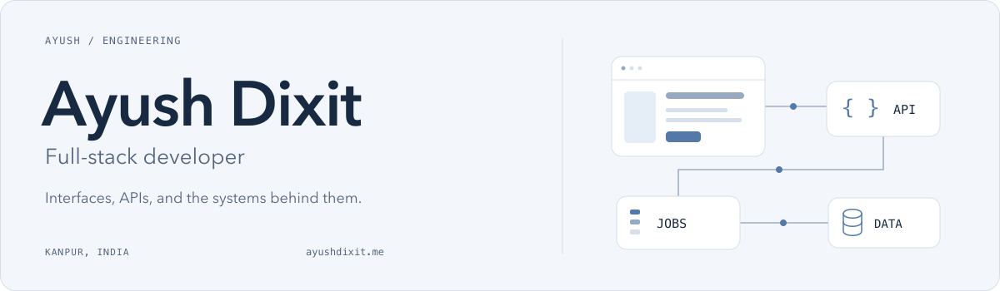
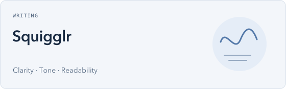
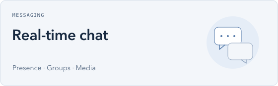
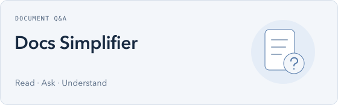
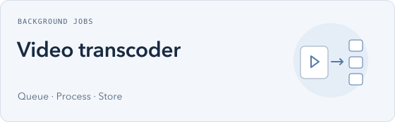

<picture>
  <source media="(max-width: 600px) and (prefers-color-scheme: dark)" srcset="./profile-assets/header-dark-mobile.svg" />
  <source media="(max-width: 600px)" srcset="./profile-assets/header-light-mobile.svg" />
  <source media="(prefers-color-scheme: dark)" srcset="./profile-assets/header-dark.svg" />
  
</picture>

 

&nbsp;

&nbsp;

&nbsp;

 

I build web applications across the frontend and backend. My projects include real-time messaging,
AI writing tools, document search, and background video processing.

I'm interested in how the pieces fit together: the interface someone uses, the data behind it,
and the services that keep it running. Most of my work is in **TypeScript**, with **React / Next.js**,
**Node.js**, and **PostgreSQL**.

  
  
  
  
  
  
  
  

 

## Selected work

<table>
  <tr>
    <td width="50%" valign="top">
      <a href="https://squigglr.app">
        <picture>
          <source media="(max-width: 600px) and (prefers-color-scheme: dark)" srcset="./profile-assets/squigglr-dark-mobile.svg" />
          <source media="(max-width: 600px)" srcset="./profile-assets/squigglr-light-mobile.svg" />
          <source media="(prefers-color-scheme: dark)" srcset="./profile-assets/squigglr-dark.svg" />
          
        </picture>
      </a>
      <h3>Squigglr</h3>
      
A writing app that revises text for clearer wording and a more natural tone, while keeping its meaning.

      
<a href="https://squigglr.app"><b>Explore the app ↗</b></a>

       
    </td>
    <td width="50%" valign="top">
      <a href="https://github.com/ayushdixit23/chat-app-client">
        <picture>
          <source media="(max-width: 600px) and (prefers-color-scheme: dark)" srcset="./profile-assets/chat-dark-mobile.svg" />
          <source media="(max-width: 600px)" srcset="./profile-assets/chat-light-mobile.svg" />
          <source media="(prefers-color-scheme: dark)" srcset="./profile-assets/chat-dark.svg" />
          
        </picture>
      </a>
      <h3>Real-time Chat</h3>
      
Private and group conversations with presence, typing indicators, read receipts, and image/video sharing.

      

        <a href="https://github.com/ayushdixit23/chat-app-client"><b>Frontend ↗</b></a> &nbsp;·&nbsp;
        <a href="https://github.com/ayushdixit23/chat-rest-server"><b>API ↗</b></a> &nbsp;·&nbsp;
        <a href="https://github.com/ayushdixit23/chat-socket-server"><b>Sockets ↗</b></a>
      

       
    </td>
  </tr>
  <tr>
    <td width="50%" valign="top">
      <a href="https://github.com/ayushdixit23/ai-docs-client">
        <picture>
          <source media="(max-width: 600px) and (prefers-color-scheme: dark)" srcset="./profile-assets/docs-dark-mobile.svg" />
          <source media="(max-width: 600px)" srcset="./profile-assets/docs-light-mobile.svg" />
          <source media="(prefers-color-scheme: dark)" srcset="./profile-assets/docs-dark.svg" />
          
        </picture>
      </a>
      <h3>Docs Simplifier</h3>
      
A documentation assistant that turns a public URL into explanations you can ask follow-up questions about.

      

        <a href="https://github.com/ayushdixit23/ai-docs-client"><b>Source ↗</b></a> &nbsp;·&nbsp;
        <a href="https://docsimplify.ayushdixit.me"><b>Live app ↗</b></a>
      

       
    </td>
    <td width="50%" valign="top">
      <a href="https://github.com/ayushdixit23/video-transcoder-worker">
        <picture>
          <source media="(max-width: 600px) and (prefers-color-scheme: dark)" srcset="./profile-assets/video-dark-mobile.svg" />
          <source media="(max-width: 600px)" srcset="./profile-assets/video-light-mobile.svg" />
          <source media="(prefers-color-scheme: dark)" srcset="./profile-assets/video-dark.svg" />
          
        </picture>
      </a>
      <h3>Video Transcoder</h3>
      
A background processing service that takes video jobs through a queue, transcodes them with FFmpeg, and uses S3 for storage.

      
<a href="https://github.com/ayushdixit23/video-transcoder-worker"><b>Source ↗</b></a>

       
    </td>
  </tr>
</table>

 

## On my desk

> **AskDocs** — a document Q&A app with streamed answers and citations back to uploaded files.

I'm working on the search and evidence side: combining semantic and keyword retrieval, selecting
useful source passages, and keeping answers grounded in them. The next step is a repeatable eval
suite to measure retrieval quality, citation accuracy, latency, and cost.

I'm also continuing to study **data structures, database design, and system design** through
project work and [practice](https://github.com/ayushdixit23/js-DSA).

 

## Experience

| Role                         | Company               | Period               | Focus                                                            |
| :--------------------------- | :-------------------- | :------------------- | :--------------------------------------------------------------- |
| **Frontend Developer**       | Sodio Technologies    | Jun 2025 – Feb 2026  | SaaS interfaces and API integration                              |
| **Full Stack Web Developer** | Grovyo                | Jun 2023 – Dec 2024  | Application development across frontend, backend, and deployment |

 

## Notes from building

I write about implementations I've worked through:

- [Building a RAG app for developer documentation](https://ayushdixit.hashnode.dev/how-i-built-my-first-rag-app-using-llms-to-simplify-developer-docs)
- [Connecting Express and Next.js with real-time sockets](https://ayushdixit.hashnode.dev/step-by-step-guide-to-implement-real-time-sockets-in-expressjs-with-nextjs)
- [Authentication in the Next.js App Router](https://ayushdixit.hashnode.dev/step-by-step-guide-to-using-nextauth-authjs-with-nextjs-app-router)

 

---

 

**Have a project or role in mind?**

Find more of my work at <a href="https://ayushdixit.me">ayushdixit.me</a>, or connect on <a href="https://www.linkedin.com/in/ayushdixitdev">LinkedIn</a>.

 

